<div align="center">

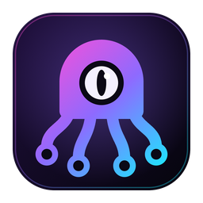

# Takode

**Run a team of Claude Code agents in parallel, each on its own branch and folder · review diffs · push and open PRs your way · test with Spotlight**<br>
**สั่งงาน Claude Code หลายตัวพร้อมกัน แต่ละตัวมี branch และโฟลเดอร์ของตัวเอง · ดู diff · push และเปิด PR ตามแบบที่ตั้งไว้ · ทดสอบด้วย Spotlight**

-000000?logo=apple&logoColor=white)


[English](#-english) · [ภาษาไทย](#-ภาษาไทย)

<br>

<a href="https://github.com/madara1150/multi-tasker/releases/latest/download/Takode-macOS.dmg"></a>
&nbsp;
<a href="https://github.com/madara1150/multi-tasker/releases/latest/download/Takode-Windows-Setup.exe"></a>

<sub>Windows portable / แบบไม่ต้องติดตั้ง: <a href="https://github.com/madara1150/multi-tasker/releases/latest/download/Takode-Windows-Portable.zip">Takode-Windows-Portable.zip</a> · All versions / ทุกเวอร์ชัน: <a href="https://github.com/madara1150/multi-tasker/releases">Releases</a></sub>

<br><br>

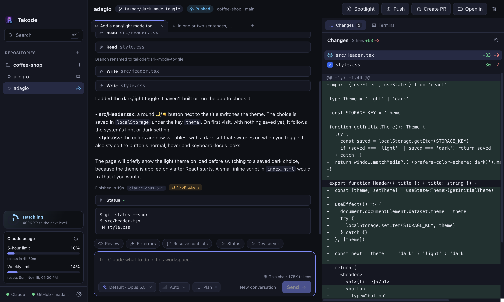

</div>

---

## 🇬🇧 English

### ✨ What it does

| ✨ Feature | Description |
|---|---|
| 🧑‍🤝‍🧑 **Many agents at once** | Create as many workspaces as you like. Each is its own git worktree and branch, so agents never overwrite each other. |
| 💬 **Chat with Claude in the app** | Describe a task, watch which files Claude reads and edits live, stop it any time and pick the conversation back up later. |
| 🔑 **Your own Claude account** | Uses the Claude Code installed on your computer and the account signed in there (Pro / Max / Team). Takode stores no password or token. |
| 🐙 **GitHub built in** | Sign in with a one-time code, clone from your repository list and open a pull request in one click. |
| 📁 **Per-repository settings** | Set everything once per repository: base branch, setup script, **branch name pattern** (for example `{user}/{date}-{name}`), **how to push** (remote, safe force push, commit message) and **how to open PRs** (target branch, draft, title and description templates, reviewers, labels). |
| 🧠 **Model, effort and plan mode in the chat** | Pick the model and how hard it thinks (Low to Max) for each workspace. Press **Plan** to get a plan first, with nothing changed, then **Run this plan**. Settings → Models reads the models your account can really use from Claude Code (with their versions, such as Opus 5.5) and lets you pick them from a list, hide some, rename them, and set what each may do and its starting effort. Each reply shows the model that answered. |
| 🚦 **Branch status at a glance** | Every workspace shows a coloured icon: grey laptop = only on this computer, blue cloud = pushed, amber = draft PR, green = PR open, purple = merged, red = PR closed. An amber dot means there are commits you have not pushed. |
| 🗂️ **Several chats per workspace** | Open more chat tabs in one workspace: each is its own Claude conversation, they run at the same time on the same branch, and each is named from its first message (double-click to rename). |
| 💻 **Terminal in the app** | The right panel has a real terminal in the workspace folder, next to the changes. Run tests, `npm run dev` or git there; it keeps running while you switch tabs. |
| 🏆 **Levels** | Level up as you use Claude in Takode, counted from the tokens it uses. 100 levels, each with its own colour and harder than the last. Every few levels unlocks something you can use: 7 themes, 7 accent colours, 9 level-ring styles (glow, sparkle, orbiting moon, comet, heartbeat, flame…), celebrations and effects, plus a new title every ten. Level 100 lights everything up in running RGB, including a frame around the whole window. |
| 👤 **Accounts** | Sign in or create an account on your own Takode server, or carry on without one: everything still works on this computer. |
| 🪙 **Tokens in the chat** | Each reply shows the tokens it used, the message box shows this chat’s total and a rough count of what you are typing. |
| ⚙️ **Lots of settings** | Interface size, spacing, font, corner roundness, code text size, animations, send with Enter or ⌘Enter, how tool calls show, notifications when Claude finishes, and more. |
| 🔄 **Updates in the app** | When a new version is out, a window pops up with what’s new. Press **Update now**: Takode downloads it, checks the file against GitHub’s SHA-256, installs it and reopens. |
| 📊 **Claude usage** | The sidebar shows how much of your 5-hour and weekly limits is used and when each resets. It updates with every reply. |
| 💬 **Fix PR review comments** | When the pull request gets comments or a change request, a bar appears with **Fix as requested**: Claude gets every unresolved comment and makes the changes. |
| ⚡ **Actions** | Per repository: **custom actions** (one-click commands such as the dev server or test suite), **Review / Fix errors / Resolve conflicts** buttons with your own instructions, PR title and description **written by Claude**, **branches named from your first message**, and general instructions sent with every message. |
| 🧩 **File-type icons** | Changed files show an icon for their type: React for `.tsx`, plus TypeScript, CSS, HTML, JSON, Python and more. |
| 🔦 **Spotlight** | Show a workspace's files in the main repository folder to test them with the dev server, `node_modules` and `.env` already there. Turn it off and everything is back as it was. |
| 🔎 **Spotlight-style search (⌘K)** | One box for everything: switch workspace, create one, change theme, open a PR. |
| 📝 **Diff view** | Every file changed against the base branch, committed or not. |
| 🎨 **Themes** | Six themes (four dark, two light) or match the system, plus accent colour and text size. |
| 🌏 **Thai / English** | Switch language instantly in Settings. |

<p align="center">
  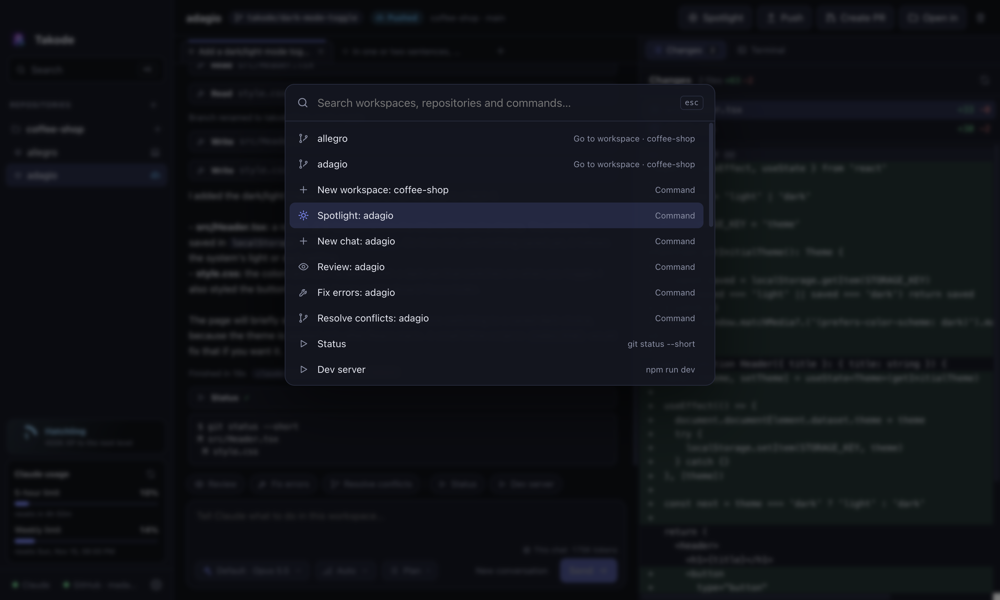
  <br><br>
  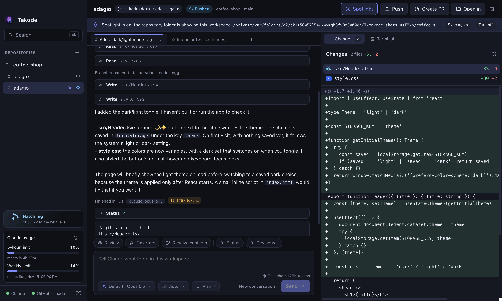
  <br><br>
  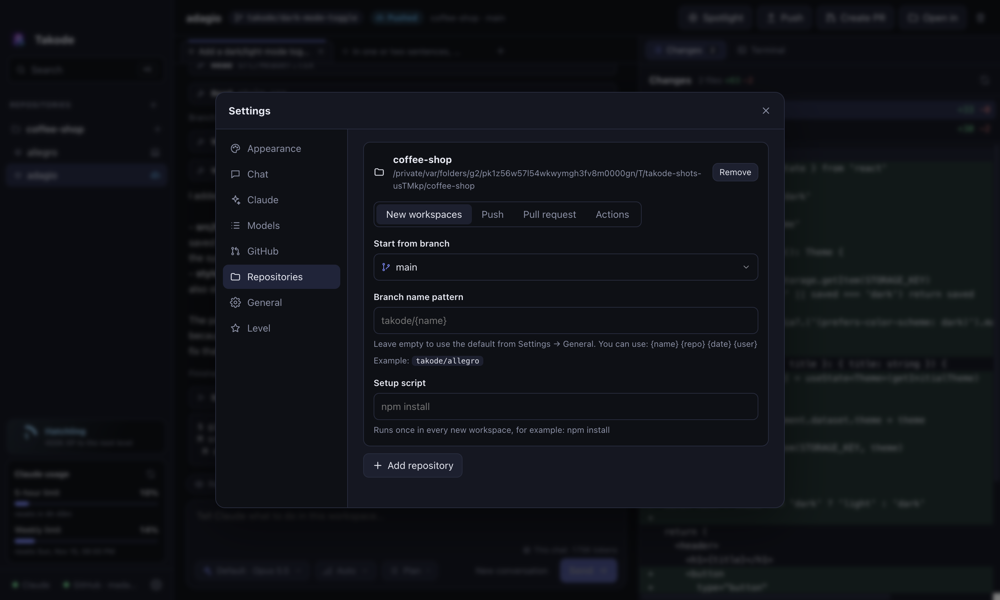
  <br><br>
  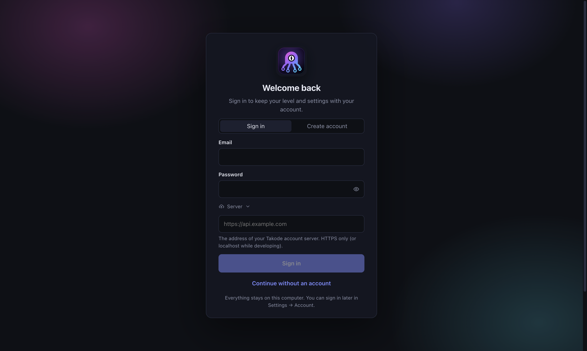
  <br><br>
  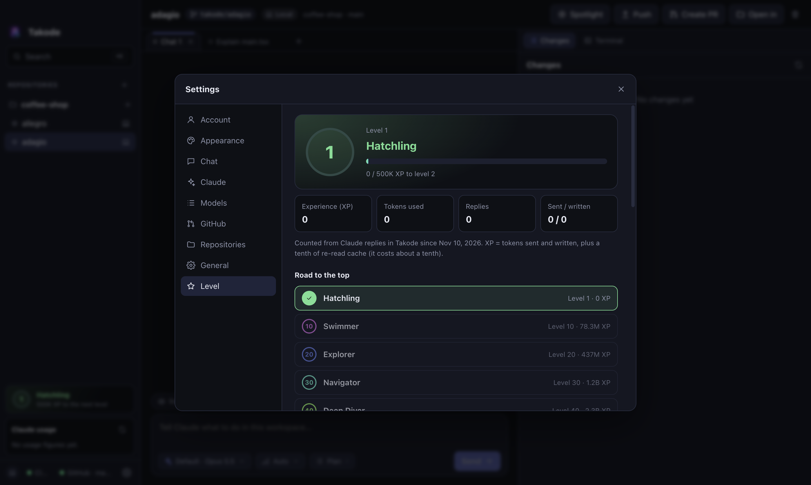
  <br><br>
  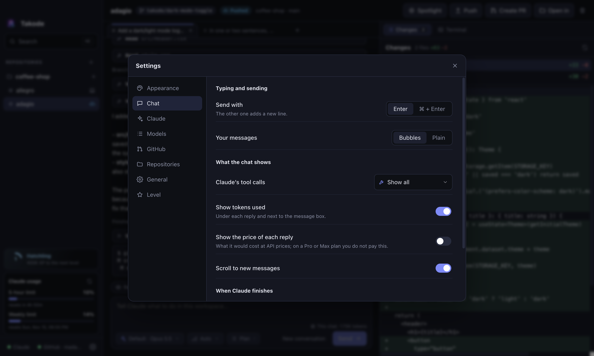
  <br><br>
  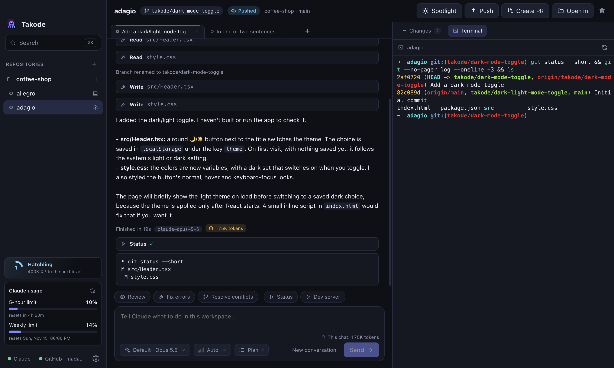
  <br><br>
  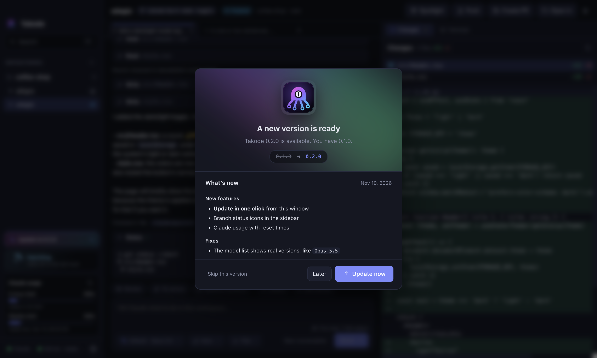
  <br><br>
  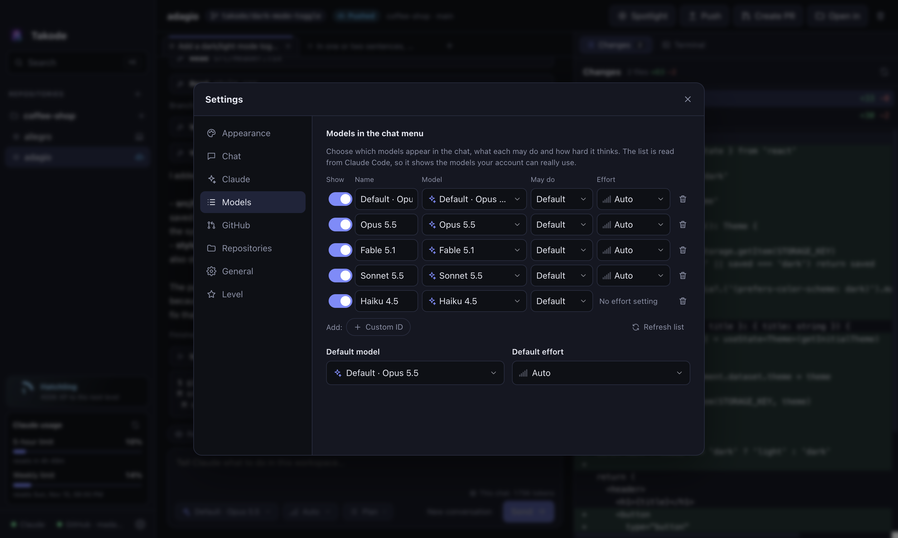
  <br><br>
  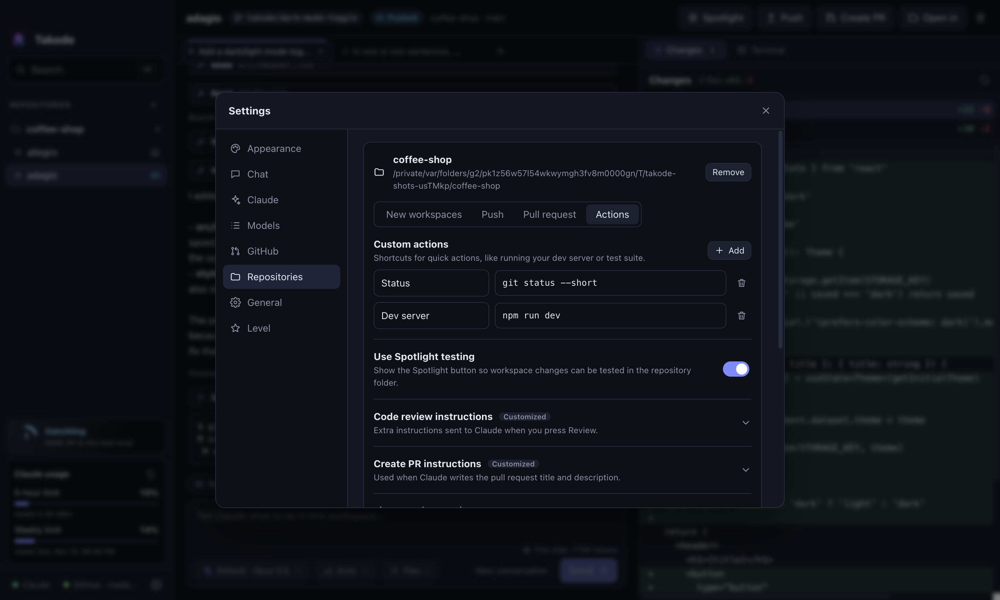
  <br><br>
  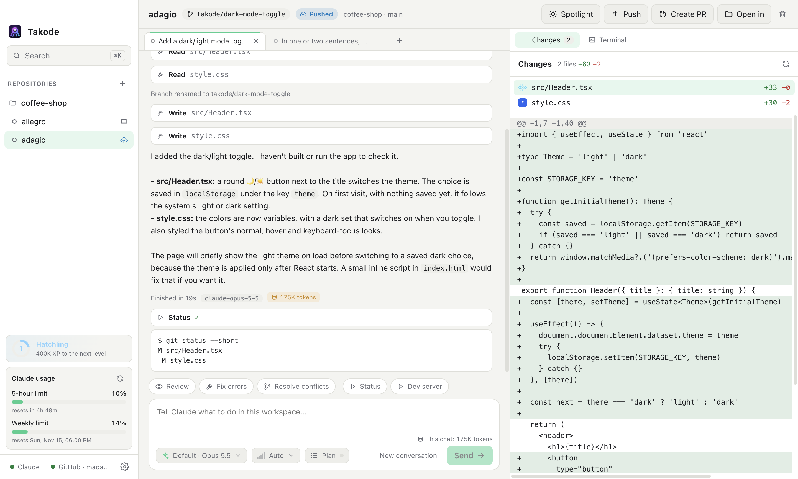
</p>

---

### 📥 Download and install

1. Install the prerequisites: [Git](https://git-scm.com), [Claude Code](https://claude.com/claude-code) and the [GitHub CLI](https://cli.github.com) (`gh`).
2. Download Takode with the buttons at the top.
   - **macOS**: open `Takode-macOS.dmg` and drag Takode to Applications.
   - **Windows**: run `Takode-Windows-Setup.exe`, or unzip the portable build and run `Takode.exe`.

---

### 🚀 How to use

1. **Sign in to Claude.** Press "Sign in" on the welcome screen (already signed in to Claude Code? It is ticked for you).
2. **Connect GitHub.** Press "Connect", copy the code Takode shows and paste it on the GitHub page that opens.
3. **Add a repository.** Pick a folder on your computer or clone one from your GitHub list.
4. **Create a workspace.** Name it (or get a random name) and choose the branch to start from.
5. **Give it a task.** Type what you want and press Enter. Create more workspaces to run several tasks side by side.
6. **Test with Spotlight.** Press Spotlight, test in the main repository folder, then press "Turn off".
7. **Push or open a PR.** Press "Push" to commit and push the branch, or "Create PR" to also open the pull request. Both follow the repository's settings (Settings → Repositories).

<p align="center">
  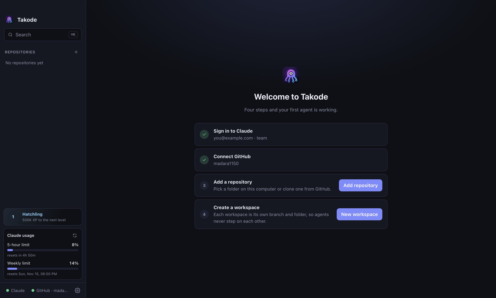
  <br><br>
  
</p>

---

### ❓ FAQ

**macOS says the app is from an unidentified developer** — right-click Takode, choose Open, then Open again. Or go to System Settings → Privacy & Security and press Open Anyway.

**Windows SmartScreen shows a warning** — press More info, then Run anyway.

**Claude will not run commands (tests, npm install)** — by default it may only edit files. Change it in Settings → Claude → "Everything" (only for repositories you trust).

**Spotlight says the repository folder has uncommitted changes** — Takode never touches a folder with unfinished work. Commit or stash it first.

**Where does my code go?** — It stays on your computer. Takode only runs the local Claude Code and `gh`; data leaves your machine the way those two tools normally send it (to Claude and to GitHub).

**Which variables can I use in patterns and templates?** — `{name}` (workspace), `{repo}`, `{date}`, `{user}` (your GitHub username), and in push/PR templates also `{branch}` and `{base}`. Example: the pattern `{user}/{date}-{name}` gives `mali/2026-11-10-allegro`.

**How do I add my own buttons?** — Settings → Repositories → Actions → Add. Give it a name and a shell command; it appears above the message box and in ⌘K. Press it again while it runs to stop it. Custom actions run as you, without asking, whatever the Claude permission setting is.

**Where are workspaces kept?** — `~/Takode/workspaces/<repo>/<name>`. Change it in Settings → General.

---

### 🛠️ Build it yourself (for developers)

```bash
npm install
npm run dev          # run the app with hot reload
npm test             # git / Spotlight tests
npm run typecheck
./build_mac.sh       # → dist/Takode-macOS.dmg
build_windows.bat    # → dist/Takode-Windows-Setup.exe, dist/Takode-Windows-Portable.zip
npm run screenshots  # retake the README screenshots from the real app
```

**Account server**: Takode signs in against your own server. It needs these JSON endpoints (details in `src/shared/auth.ts`):

| Method and path | Body | Reply |
|---|---|---|
| `POST /auth/register` | `{ name, email, password }` | `201 { token, account }`, `409` if the email is taken |
| `POST /auth/login` | `{ email, password }` | `200 { token, account }`, `401` if wrong |
| `GET /auth/me` | header `Authorization: Bearer <token>` | `200 { account }`, `401` when the session is over |
| `POST /auth/logout` | header `Authorization: Bearer <token>` | `204` |
| `POST /redeem` | `{ code }` + header `Authorization: Bearer <token>` | `200 { xp?, unlocks?, message? }`, `404` unknown, `409` already used, `410` expired |
| `GET /me/progress` | header `Authorization: Bearer <token>` | `200 { stats, unlocks, redeemed, updatedAt }`, `404` if the server does not keep progress |
| `PUT /me/progress` | same body as above + the header | `200` or `204` |

Levels belong to accounts: each account has its own level on this computer, and when the server answers `/me/progress` the level follows the account to other computers (the newest copy wins; unlocks and redeemed codes from both are kept). Until then Takode keeps it on this computer only. Don't trust the XP a client sends blindly; check it on the server. `unlocks` lists rewards as `kind:id` from `src/shared/rewards.ts`, e.g. `["effect:rgbFrame", "theme:abyss"]`. The server decides what each code gives and remembers who used it; the mock server has the sample codes `WELCOME500`, `RGBPARTY` and `DEEPSEA`.

`account` is `{ id, name, email, avatarUrl? }`. The server must use HTTPS (plain HTTP is allowed only for `localhost`). Takode keeps the token encrypted with the operating system's key store and never stores the password. To try it without a server, run `npm run mock-server` and use `http://localhost:8787` (in-memory, for testing only).

**Releasing a new version** (the in-app update reads GitHub Releases):

1. Raise `version` in `package.json` (for example `0.2.0`).
2. Build with `./build_mac.sh` and `build_windows.bat`.
3. Create a GitHub release in this repository tagged `v0.2.0`, write what’s new in its description, and upload `Takode-macOS.dmg`, `Takode-Windows-Setup.exe` and `Takode-Windows-Portable.zip` with exactly these names.

Everyone on an older version then sees the update window within a few hours, or right away from Settings → General → Check for updates.

Layout: `src/main` (Electron: git, GitHub, Claude) · `src/renderer` (React UI) · `src/shared` (types) · `tests` · `tools`

### 📄 License

[MIT](LICENSE) © 2026 Tanathip

---

## 🇹🇭 ภาษาไทย

### ✨ ทำอะไรได้บ้าง

| ✨ ฟีเจอร์ | คำอธิบาย |
|---|---|
| 🧑‍🤝‍🧑 **หลาย agent พร้อมกัน** | สร้าง workspace ได้ไม่จำกัด แต่ละอันคือ git worktree + branch ของตัวเอง Claude แต่ละตัวจึงไม่แก้ไฟล์ทับกัน |
| 💬 **คุยกับ Claude ในแอป** | พิมพ์งานที่ต้องการ ดูว่า Claude อ่าน/แก้ไฟล์ไหนแบบสด กดหยุดได้ และคุยต่อจากเดิมได้ |
| 🔑 **ใช้บัญชี Claude ของคุณ** | ใช้ Claude Code ที่ติดตั้งในเครื่องและบัญชีที่ login ไว้ (Pro / Max / Team) แอปไม่เก็บรหัสผ่านหรือ token |
| 🐙 **เชื่อม GitHub** | login ด้วยรหัสครั้งเดียว เลือก clone repository จากรายการ และเปิด pull request ได้ในคลิกเดียว |
| 📁 **ตั้งค่าแยกแต่ละ repository** | ตั้งครั้งเดียวต่อ repository: branch ตั้งต้น, setup script, **แพทเทิร์นชื่อ branch** (เช่น `{user}/{date}-{name}`), **วิธี push** (remote, force push แบบปลอดภัย, ข้อความ commit) และ **วิธีเปิด PR** (branch ปลายทาง, draft, แม่แบบหัวข้อและรายละเอียด, ผู้รีวิว, label) |
| 🧠 **เลือก model ระดับ และ plan mode ในแชต** | เลือก model และระดับความคิด (ต่ำถึงสูงสุด) แยกแต่ละ workspace กด **Plan** เพื่อให้วางแผนก่อนโดยยังไม่แก้อะไร แล้วกด **ทำตามแผนนี้** ที่ ตั้งค่า → Model แอปอ่านรายการ model ที่บัญชีของคุณใช้ได้จริงจาก Claude Code (พร้อมเวอร์ชัน เช่น Opus 5.5) ให้เลือกจากรายการ ซ่อนบางตัว เปลี่ยนชื่อ และกำหนดว่าแต่ละตัวทำอะไรได้และเริ่มที่ระดับไหน ทุกคำตอบแสดงชื่อ model ที่ตอบจริง |
| 🚦 **สถานะ branch ดูได้ทันที** | ทุก workspace มีไอคอนสีบอกสถานะ: แล็ปท็อปสีเทา = อยู่ในเครื่องเท่านั้น, เมฆสีฟ้า = push แล้ว, สีส้ม = PR แบบ draft, สีเขียว = เปิด PR อยู่, สีม่วง = merge แล้ว, สีแดง = PR ถูกปิด จุดสีส้มบนไอคอนแปลว่ามี commit ที่ยังไม่ได้ push |
| 🗂️ **หลายแชทใน workspace เดียว** | เปิดแชทได้หลาย tab ใน workspace เดียว แต่ละ tab เป็นบทสนทนา Claude แยกกัน ทำงานพร้อมกันบน branch เดียวกัน และตั้งชื่อจากข้อความแรกให้เอง (ดับเบิลคลิกเพื่อเปลี่ยนชื่อ) |
| 💻 **Terminal ในแอป** | แผงขวามี terminal จริงที่เปิดอยู่ในโฟลเดอร์ของ workspace ข้างแท็บการเปลี่ยนแปลง รันเทสต์ `npm run dev` หรือ git ได้เลย และยังทำงานต่อแม้สลับไปดูอย่างอื่น |
| 🏆 **ระบบเลเวล** | เลเวลขึ้นตามการใช้ Claude ใน Takode นับจาก token ที่ใช้ไป มี 100 เลเวล แต่ละเลเวลมีสีของตัวเองและยากขึ้นเรื่อยๆ ทุกไม่กี่เลเวลปลดล็อกของที่ใช้ได้จริง: ธีม 7 แบบ สีเน้น 7 สี กรอบวงเลเวล 9 แบบ (เรืองแสง ประกาย จันทร์โคจร ดาวหาง ชีพจร เปลวไฟ…) เอฟเฟกต์ฉลองและเอฟเฟกต์อื่นๆ และฉายาใหม่ทุก 10 เลเวล เลเวล 100 เปิดไฟวิ่ง RGB ทั้งหมด รวมถึงกรอบไฟรอบหน้าต่าง |
| 👤 **บัญชีผู้ใช้** | เข้าสู่ระบบหรือสมัครสมาชิกกับเซิร์ฟเวอร์ Takode ของคุณเอง หรือใช้งานโดยไม่มีบัญชีก็ได้ ทุกอย่างยังทำงานในเครื่องเหมือนเดิม |
| 🪙 **token ในแชท** | ทุกคำตอบบอก token ที่ใช้ ช่องพิมพ์แสดงยอดรวมของแชทนั้นและค่าประมาณของข้อความที่กำลังพิมพ์ |
| ⚙️ **ตั้งค่าได้เยอะ** | ขนาดหน้าจอ ระยะห่าง ฟอนต์ ความโค้งของมุม ขนาดตัวอักษรโค้ด แอนิเมชัน ส่งด้วย Enter หรือ ⌘Enter การแสดง tool การแจ้งเตือนเมื่อ Claude ทำงานเสร็จ และอื่นๆ |
| 🔄 **อัปเดตในแอป** | เมื่อมีเวอร์ชันใหม่ จะมีหน้าต่างเด้งบอกว่ามีอะไรใหม่ กด **อัปเดตเลย** แล้ว Takode จะดาวน์โหลด ตรวจไฟล์กับค่า SHA-256 ของ GitHub ติดตั้ง และเปิดขึ้นมาใหม่เอง |
| 📊 **โควตา Claude** | แถบด้านซ้ายแสดงว่าใช้โควตารอบ 5 ชั่วโมงและรอบ 7 วันไปเท่าไร และแต่ละรอบจะรีเซ็ตเมื่อไร ตัวเลขอัปเดตทุกครั้งที่ Claude ตอบ |
| 💬 **แก้ตาม comment ใน PR** | เมื่อ pull request มี comment หรือถูกขอให้แก้ไข จะมีแถบพร้อมปุ่ม **แก้ตามที่ขอ** Claude จะได้รับทุก comment ที่ยังไม่ resolve แล้วแก้ให้ |
| ⚡ **Actions** | ตั้งต่อ repository: **action ที่สร้างเอง** (คำสั่งคลิกเดียว เช่น dev server หรือชุดทดสอบ), ปุ่ม **Review / แก้ error / แก้ conflict** พร้อมคำสั่งเพิ่มเติมของคุณเอง, ให้ **Claude เขียนหัวข้อและรายละเอียด PR**, **ตั้งชื่อ branch จากข้อความแรก** และคำสั่งทั่วไปที่ส่งไปกับทุกข้อความ |
| 🧩 **ไอคอนตามชนิดไฟล์** | ไฟล์ที่เปลี่ยนแสดงไอคอนตามชนิด: React สำหรับ `.tsx` รวมถึง TypeScript, CSS, HTML, JSON, Python และอื่นๆ |
| 🔦 **Spotlight** | นำไฟล์ของ workspace ไปแสดงในโฟลเดอร์ repository หลัก เพื่อทดสอบกับ dev server, `node_modules` และ `.env` ที่มีอยู่แล้ว กดปิดแล้วทุกอย่างกลับเหมือนเดิม |
| 🔎 **ค้นหาแบบ Spotlight (⌘K)** | ช่องเดียวไปได้ทุกที่: สลับ workspace, สร้าง workspace, เปลี่ยนธีม, เปิด PR |
| 📝 **ดู diff** | เห็นทุกไฟล์ที่เปลี่ยนเทียบกับ branch ตั้งต้น ทั้งที่ commit แล้วและยังไม่ commit |
| 🎨 **ธีม** | 6 ธีม (มืด 4 สว่าง 2) หรือตามระบบ เลือกสีเน้นและขนาดตัวอักษรได้ |
| 🌏 **ไทย / อังกฤษ** | สลับภาษาได้ทันทีในหน้าตั้งค่า |

<p align="center">
  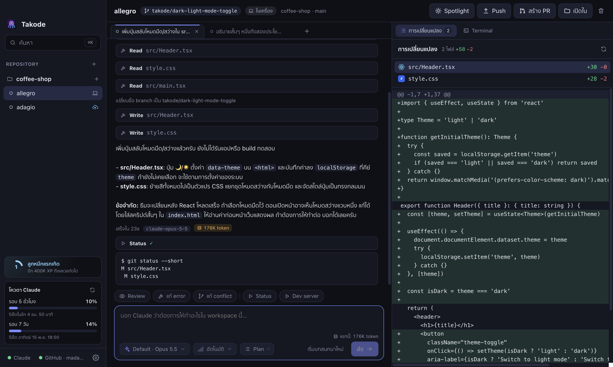
  <br><br>
  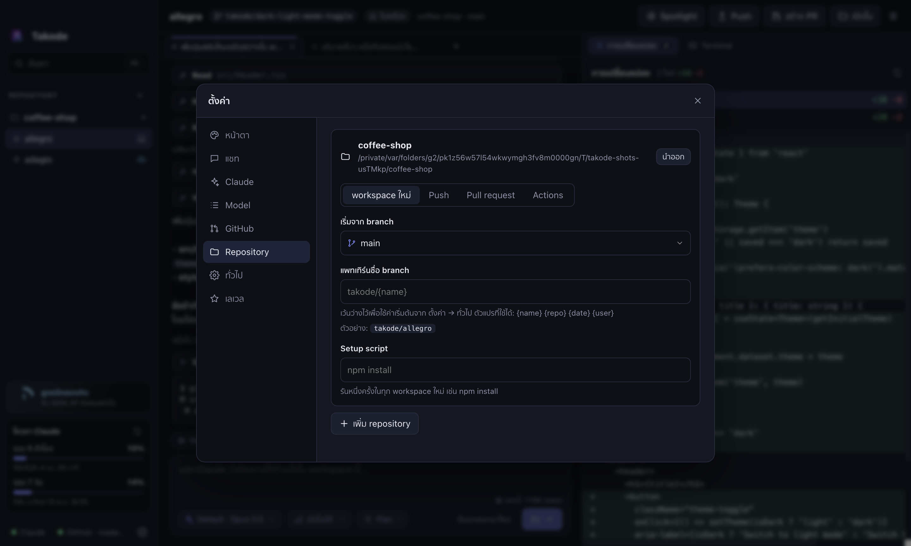
  <br><br>
  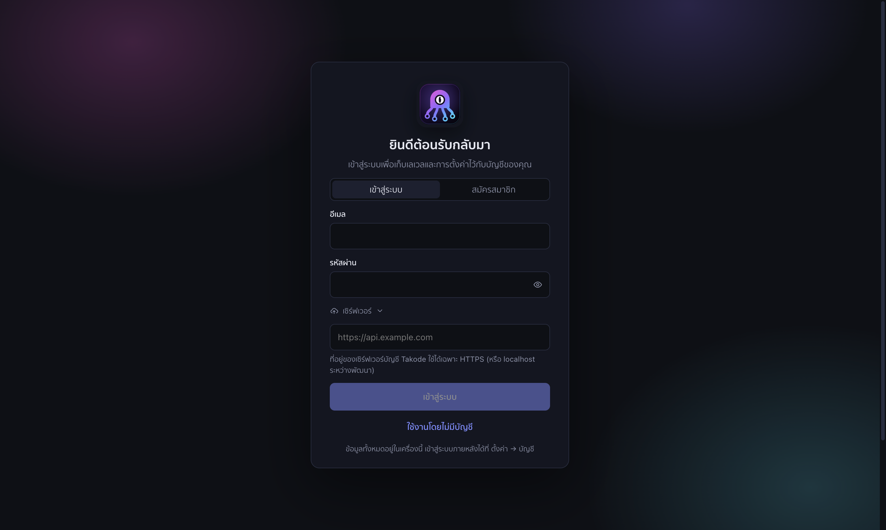
  <br><br>
  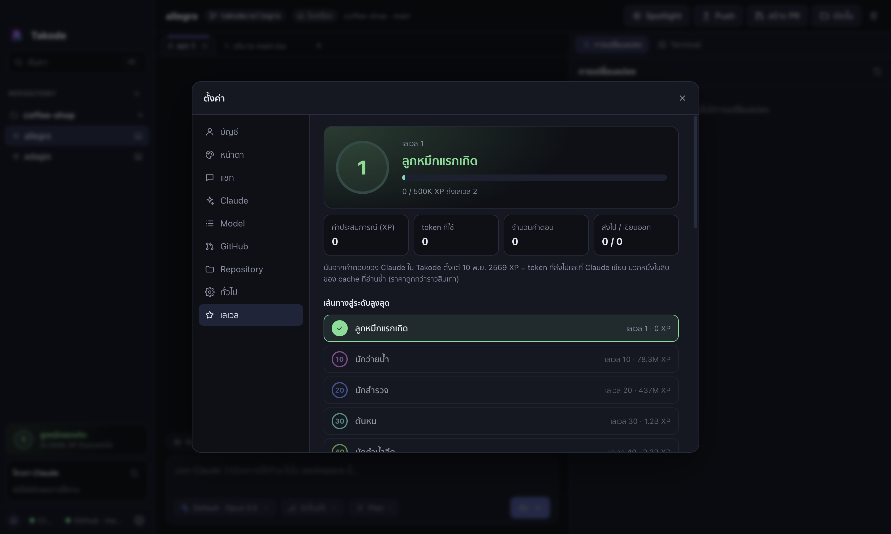
  <br><br>
  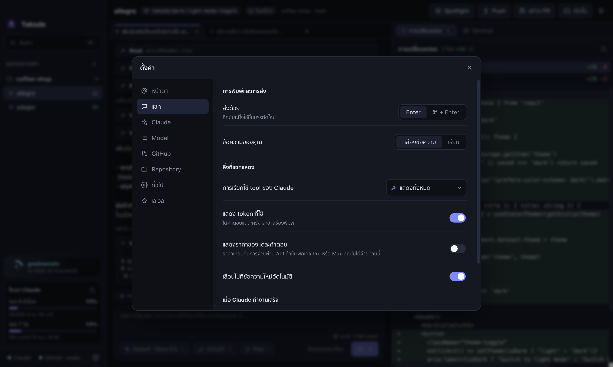
  <br><br>
  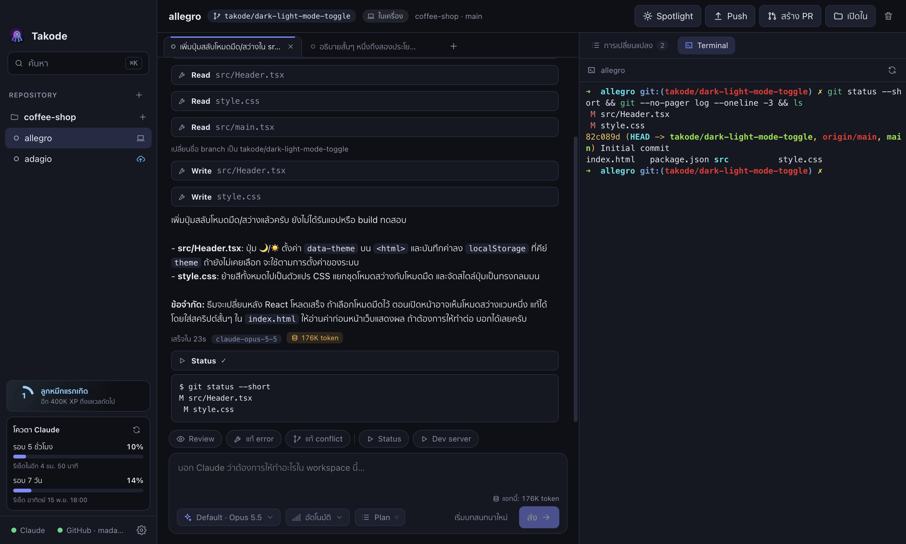
  <br><br>
  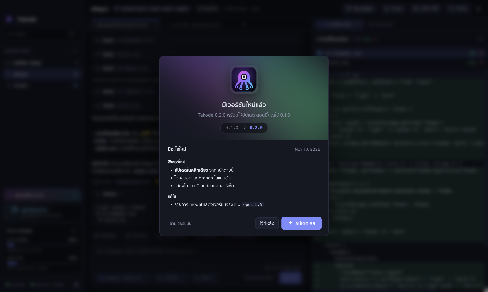
  <br><br>
  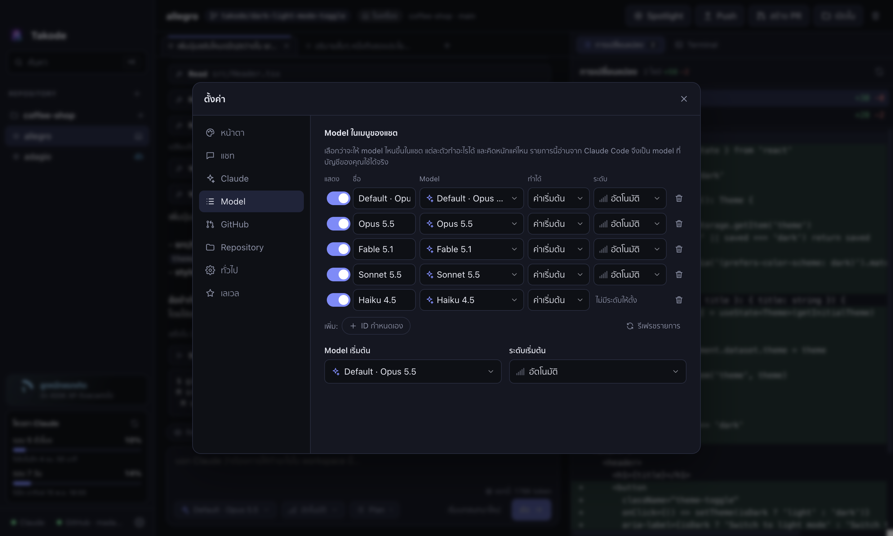
  <br><br>
  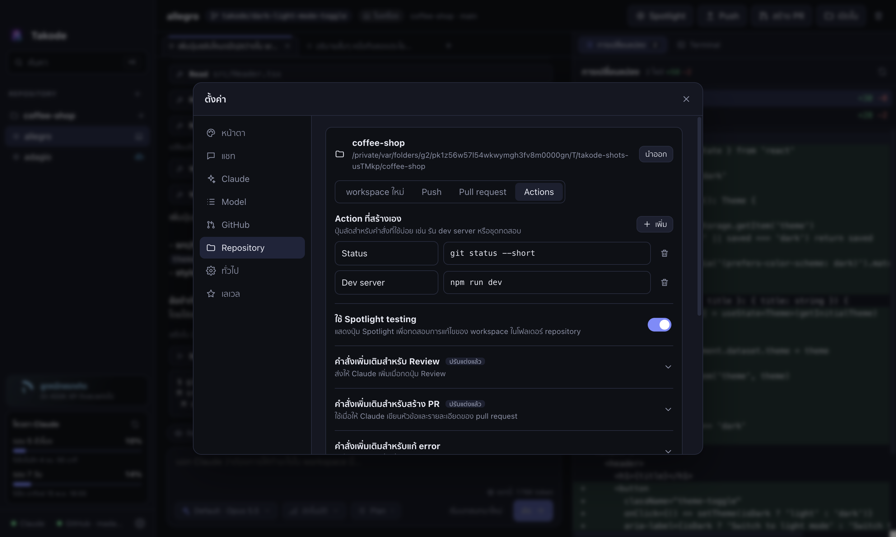
  <br><br>
  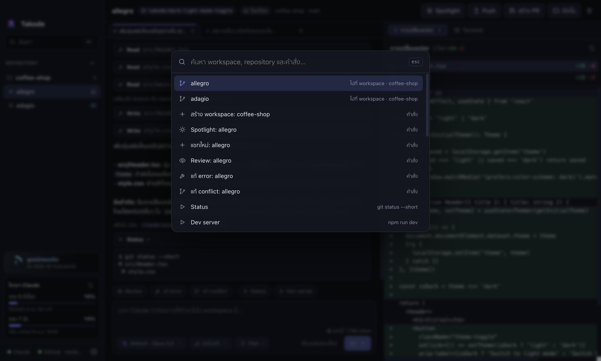
  <br><br>
  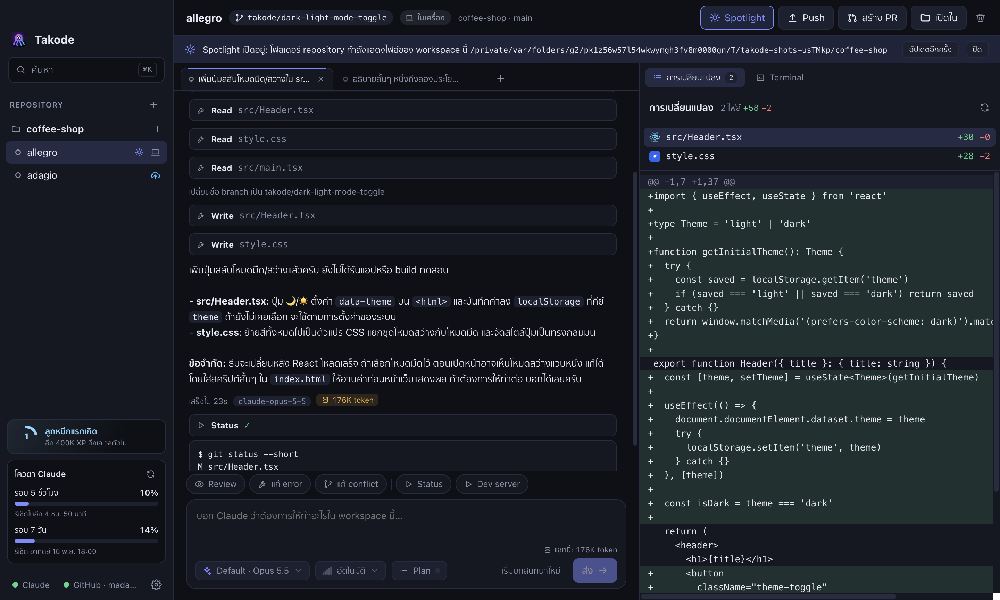
  <br><br>
  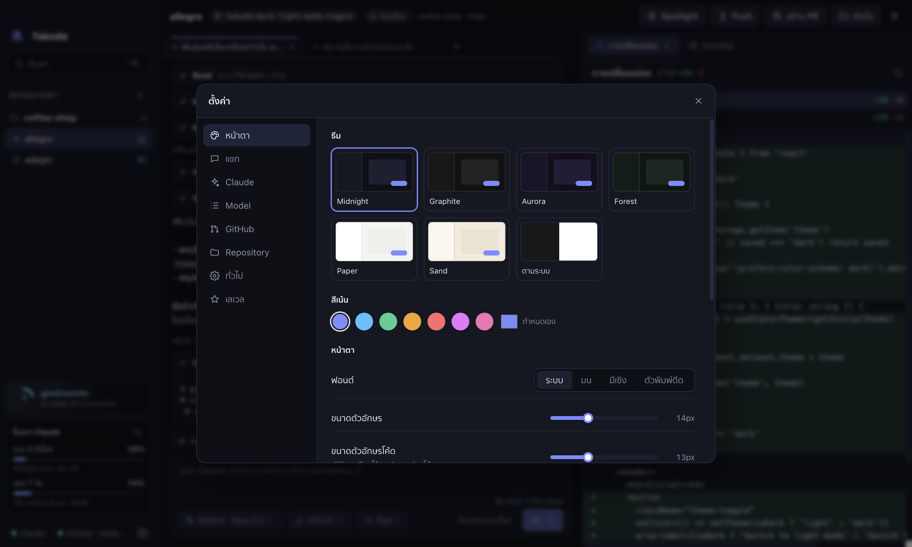
</p>

---

### 📥 ดาวน์โหลดและติดตั้ง

1. ติดตั้งสิ่งที่ต้องมีก่อน: [Git](https://git-scm.com), [Claude Code](https://claude.com/claude-code) และ [GitHub CLI](https://cli.github.com) (`gh`)
2. ดาวน์โหลด Takode จากปุ่มด้านบน
   - **macOS**: เปิด `Takode-macOS.dmg` แล้วลาก Takode ไปที่ Applications
   - **Windows**: เปิด `Takode-Windows-Setup.exe` หรือแตกไฟล์ Portable แล้วเปิด `Takode.exe`

---

### 🚀 วิธีใช้

1. **เข้าสู่ระบบ Claude** กดปุ่ม "เข้าสู่ระบบ" ในหน้าแรก (ถ้า login Claude Code ไว้แล้วจะขึ้นเครื่องหมายถูกเอง)
2. **เชื่อม GitHub** กด "เชื่อมต่อ" แอปจะแสดงรหัส ให้คัดลอกไปวางในหน้า GitHub ที่เปิดขึ้นมา
3. **เพิ่ม repository** เลือกโฟลเดอร์ในเครื่อง หรือ clone จากรายการ GitHub
4. **สร้าง workspace** ตั้งชื่อ (หรือปล่อยให้สุ่ม) และเลือก branch ตั้งต้น
5. **สั่งงาน** พิมพ์สิ่งที่ต้องการแล้วกด Enter สร้าง workspace เพิ่มเพื่อให้หลายงานเดินพร้อมกันได้
6. **ทดสอบด้วย Spotlight** กดปุ่ม Spotlight แล้วทดสอบในโฟลเดอร์ repository หลัก เสร็จแล้วกด "ปิด"
7. **Push หรือเปิด PR** กด "Push" เพื่อ commit และ push branch หรือกด "สร้าง PR" เพื่อเปิด pull request ด้วย ทั้งสองปุ่มทำตามที่ตั้งไว้ใน ตั้งค่า → Repository

<p align="center">
  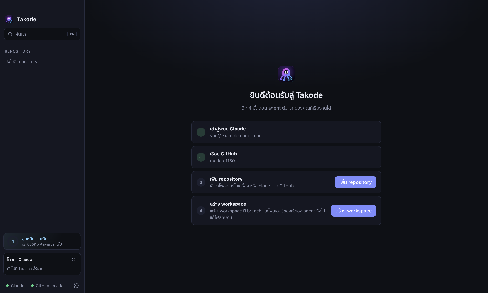
</p>

---

### ❓ คำถามที่พบบ่อย

**macOS แจ้งว่าเปิดไม่ได้เพราะไม่รู้จักผู้พัฒนา** — คลิกขวาที่ Takode เลือก Open แล้วกด Open อีกครั้ง หรือไปที่ System Settings → Privacy & Security แล้วกด Open Anyway

**Windows SmartScreen ขึ้นเตือน** — กด More info แล้วกด Run anyway

**Claude ไม่ยอมรันคำสั่ง (เช่น test หรือ npm install)** — ค่าเริ่มต้นอนุญาตเฉพาะการแก้ไฟล์ เปลี่ยนได้ที่ ตั้งค่า → Claude → "ทุกอย่าง" (ใช้กับ repository ที่ไว้ใจเท่านั้น)

**Spotlight แจ้งว่าโฟลเดอร์ repository มีไฟล์ที่แก้ค้างไว้** — Takode จะไม่แตะโฟลเดอร์ที่มีงานค้าง ให้ commit หรือ stash ก่อน

**ไฟล์ของฉันถูกส่งไปไหนบ้าง** — โค้ดอยู่ในเครื่องคุณ Takode เรียก Claude Code และ `gh` ในเครื่องเท่านั้น ข้อมูลจะออกจากเครื่องตามการทำงานปกติของสองโปรแกรมนั้น (ส่งให้ Claude และ GitHub)

**ใช้ตัวแปรอะไรในแพทเทิร์นและแม่แบบได้บ้าง** — `{name}` (ชื่อ workspace), `{repo}`, `{date}`, `{user}` (ชื่อผู้ใช้ GitHub) และในแม่แบบ push/PR ใช้ `{branch}` กับ `{base}` ได้ด้วย เช่น แพทเทิร์น `{user}/{date}-{name}` จะได้ `mali/2026-11-10-allegro`

**เพิ่มปุ่มของตัวเองได้อย่างไร** — ตั้งค่า → Repository → Actions → เพิ่ม ใส่ชื่อและคำสั่ง shell ปุ่มจะขึ้นเหนือช่องพิมพ์ข้อความและใน ⌘K กดซ้ำระหว่างที่รันอยู่เพื่อหยุด action ที่สร้างเองจะรันด้วยสิทธิ์ของคุณทันทีโดยไม่ถาม ไม่ขึ้นกับค่าสิทธิ์ของ Claude

**workspace เก็บไว้ที่ไหน** — `~/Takode/workspaces/<repo>/<ชื่อ>` เปลี่ยนได้ที่ ตั้งค่า → ทั่วไป

---

### 🛠️ build เอง (สำหรับนักพัฒนา)

```bash
npm install
npm run dev          # เปิดแอปแบบ hot reload
npm test             # ทดสอบ git / Spotlight
npm run typecheck
./build_mac.sh       # → dist/Takode-macOS.dmg
build_windows.bat    # → dist/Takode-Windows-Setup.exe, dist/Takode-Windows-Portable.zip
npm run screenshots  # ถ่ายภาพ README ใหม่จากแอปจริง
```

**เซิร์ฟเวอร์บัญชี**: Takode เข้าสู่ระบบกับเซิร์ฟเวอร์ของคุณเอง ซึ่งต้องมี endpoint แบบ JSON ดังนี้ แบบ JSON (รายละเอียดใน `src/shared/auth.ts`):

| Method และ path | ข้อมูลที่ส่ง | ผลตอบกลับ |
|---|---|---|
| `POST /auth/register` | `{ name, email, password }` | `201 { token, account }` หรือ `409` ถ้าอีเมลซ้ำ |
| `POST /auth/login` | `{ email, password }` | `200 { token, account }` หรือ `401` ถ้าผิด |
| `GET /auth/me` | header `Authorization: Bearer <token>` | `200 { account }` หรือ `401` เมื่อ session หมดอายุ |
| `POST /auth/logout` | header `Authorization: Bearer <token>` | `204` |
| `POST /redeem` | `{ code }` + header `Authorization: Bearer <token>` | `200 { xp?, unlocks?, message? }`, `404` ไม่มีโค้ดนี้, `409` ใช้ไปแล้ว, `410` หมดอายุ |
| `GET /me/progress` | header `Authorization: Bearer <token>` | `200 { stats, unlocks, redeemed, updatedAt }` หรือ `404` ถ้าเซิร์ฟเวอร์ยังไม่เก็บเลเวล |
| `PUT /me/progress` | ข้อมูลแบบเดียวกับด้านบน + header | `200` หรือ `204` |

เลเวลผูกกับบัญชี: แต่ละบัญชีมีเลเวลของตัวเองในเครื่อง และเมื่อเซิร์ฟเวอร์ตอบ `/me/progress` ได้ เลเวลจะตามบัญชีไปทุกเครื่อง (ข้อมูลที่ใหม่กว่าชนะ ส่วนของที่ปลดล็อกและโค้ดที่ใช้แล้วจะรวมจากทั้งสองฝั่ง) ระหว่างที่ยังไม่มี Takode จะเก็บไว้ในเครื่องอย่างเดียว ฝั่งเซิร์ฟเวอร์ไม่ควรเชื่อ XP ที่แอปส่งมาโดยไม่ตรวจ `unlocks` คือรายการรางวัลแบบ `kind:id` จาก `src/shared/rewards.ts` เช่น `["effect:rgbFrame", "theme:abyss"]` เซิร์ฟเวอร์เป็นคนตัดสินว่าโค้ดไหนให้อะไร และจำว่าใครใช้ไปแล้ว ใน mock server มีโค้ดตัวอย่าง `WELCOME500`, `RGBPARTY` และ `DEEPSEA`

`account` คือ `{ id, name, email, avatarUrl? }` เซิร์ฟเวอร์ต้องใช้ HTTPS (HTTP ธรรมดาใช้ได้เฉพาะ `localhost`) Takode เก็บ token แบบเข้ารหัสด้วยระบบเก็บกุญแจของ OS และไม่เก็บรหัสผ่าน ถ้ายังไม่มีเซิร์ฟเวอร์ ให้รัน `npm run mock-server` แล้วใช้ `http://localhost:8787` (เก็บในหน่วยความจำ ใช้ทดสอบเท่านั้น)

**ออกเวอร์ชันใหม่** (ระบบอัปเดตในแอปอ่านจาก GitHub Releases):

1. เพิ่ม `version` ใน `package.json` (เช่น `0.2.0`)
2. build ด้วย `./build_mac.sh` และ `build_windows.bat`
3. สร้าง GitHub release ใน repository นี้ด้วย tag `v0.2.0` เขียนว่ามีอะไรใหม่ในรายละเอียด และอัปโหลด `Takode-macOS.dmg`, `Takode-Windows-Setup.exe` และ `Takode-Windows-Portable.zip` โดยใช้ชื่อตามนี้เป๊ะ

ทุกคนที่ใช้เวอร์ชันเก่าจะเห็นหน้าต่างอัปเดตภายในไม่กี่ชั่วโมง หรือทันทีเมื่อกด ตั้งค่า → ทั่วไป → ตรวจหาอัปเดต

โครงสร้าง: `src/main` (Electron: git, GitHub, Claude) · `src/renderer` (React UI) · `src/shared` (types) · `tests` · `tools`

### 📄 License

[MIT](LICENSE) © 2026 Tanathip
